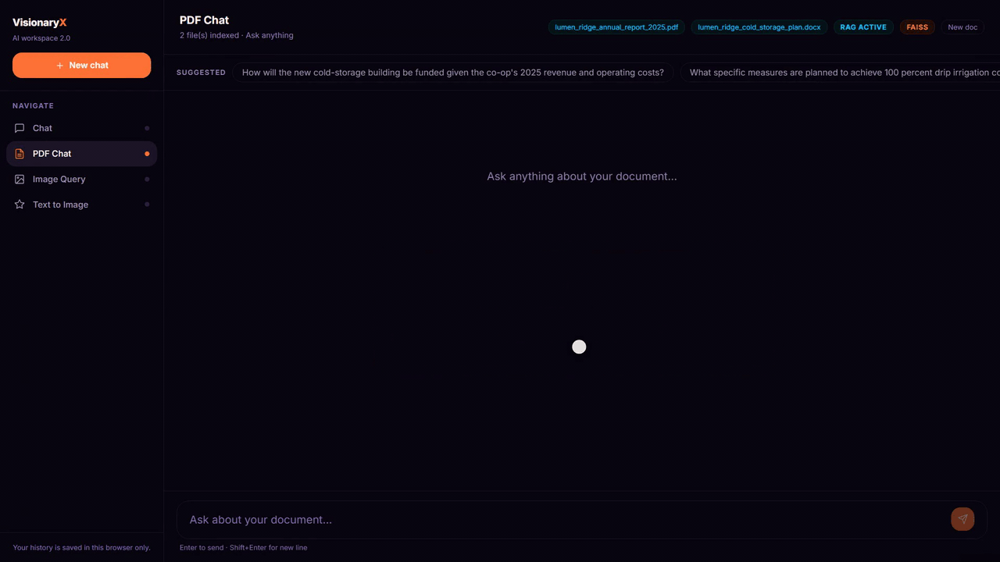
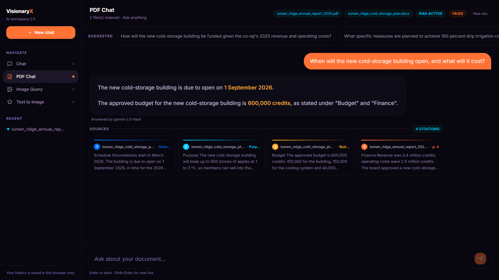
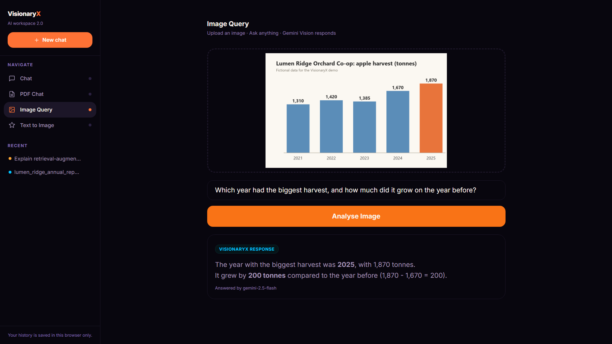
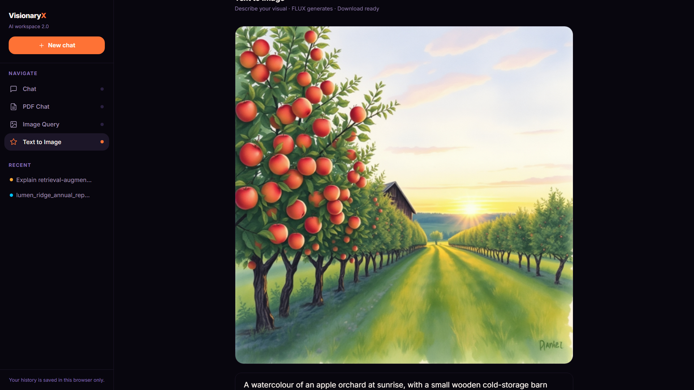
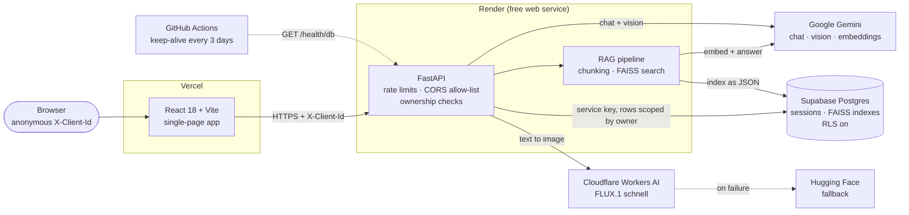
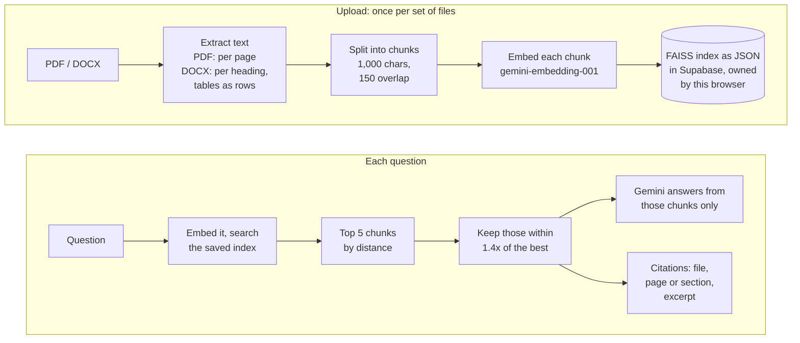

# VisionaryX 2.0

[](https://github.com/siddhant-17-codes/VisionaryX-2.0/actions/workflows/ci.yml)
[](./LICENSE)


**An AI workspace that cites its sources: ask questions across your PDFs and Word files
and every answer names the file, page or section it came from. It also answers questions
about images and generates new ones.**

Built by **Siddhant Thakur** · [GitHub](https://github.com/siddhant-17-codes) · [LinkedIn](https://www.linkedin.com/in/siddhantthakur-/)

**Live:** [visionaryx-dusky.vercel.app](https://visionaryx-dusky.vercel.app)



<!-- VIDEO: the full walkthrough (chat, PDF and DOCX with citations, image query, text to image) goes here as a GitHub user-attachments URL. -->

**At a glance:** four AI features in one workspace · retrieval-augmented answers with
file, page and section citations · runs entirely on free tiers (Vercel, Render, Supabase,
Gemini, Cloudflare Workers AI) · 123 backend and 53 frontend tests, all passing
(2026-10-31).

**Contents:** [Problem](#the-problem) · [What it does](#what-it-does) ·
[Architecture](#architecture) · [Stack](#tech-stack) ·
[RAG and citations](#how-rag-and-citations-work) ·
[Engineering decisions](#engineering-decisions) · [Run it locally](#run-it-locally) ·
[Status and limits](#status-and-limits) · [Roadmap](#roadmap)

---

## The problem

A chatbot that has read your documents will answer confidently whether or not the answer
is in them. Once a model mixes what it was given with what it already "knows", you can no
longer tell a fact from your file apart from a plausible guess, and checking means
re-reading the documents yourself.

VisionaryX answers **only** from the passages it retrieved, says so when the answer is not
there, and shows those passages as numbered sources under the answer: which file, which
page of a PDF or which heading of a Word document, and the text itself. You can check an
answer in seconds instead of trusting it.

It started in 2024 as a university minor project. Version 2.0 rebuilt it as a full-stack
app, and in October 2026 I revived the deployment, which had stopped working, and audited
and hardened it (see [Engineering decisions](#engineering-decisions)).

## What it does

| Feature | What you do | What you get |
|---|---|---|
| **PDF Chat (RAG)** | Upload up to five PDF or DOCX files at once and ask a question | An answer drawn only from your files, with numbered source cards naming the file and the page or section; three suggested questions after each upload |
| **General Chat** | Talk to the model | A multi-turn conversation that keeps its context, saved in your history |
| **Image Query** | Upload an image (a chart, a photo, a screenshot) and ask about it | Gemini's answer about that image |
| **Text to Image** | Describe a picture | A FLUX.1 [schnell] image you can download |

Every answer says which model actually wrote it ("Answered by gemini-2.5-flash"), because
when the main model's free quota runs out a lighter one takes over.



| Image Query | Text to Image |
|---|---|
|  |  |

## Architecture



There are no accounts. The browser creates a random ID once, keeps it in `localStorage`
and sends it as `X-Client-Id`; the backend stores only its SHA-256 and shows each browser
only its own conversations.

```text
backend/     FastAPI app: routers/ (HTTP), services/ (Gemini, RAG, images), core/ (chunking,
             embeddings, FAISS codec, storage, rate limits), tests/ (pytest, all upstreams faked)
frontend/    React app: pages/, components/, hooks/, api/ (axios client), utils/
supabase/    schema.sql for a fresh project
examples/    fictional files to try it with (used in the demo)
scripts/     demo/ (the Playwright recorder for the video above), checks/ (mobile layout check)
```

## Tech stack

| Layer | Technology |
|---|---|
| Frontend | React 18, Vite 6, React Router 7, Tailwind CSS 3, axios, react-markdown; hosted on Vercel |
| Backend | Python 3.12, FastAPI 0.115, Pydantic 2, Uvicorn; hosted on Render (free tier) |
| Language models | Google Gemini via `google-genai` 2.8: `gemini-2.5-flash`, falling back to `gemini-3.5-flash-lite` and `gemini-3.1-flash-lite` |
| Retrieval | LangChain text splitter, `gemini-embedding-001` embeddings, FAISS (`faiss-cpu`) |
| Documents | `pypdf` (PDF pages), `python-docx` (headings and tables) |
| Storage | Supabase Postgres through its REST API (`postgrest`), row-level security on |
| Image generation | FLUX.1 [schnell] on Cloudflare Workers AI, Hugging Face Inference Providers as fallback |
| Tests and CI | pytest, Vitest + Testing Library, ruff, ESLint; GitHub Actions on every push |

## How RAG and citations work



1. **Extraction keeps the location.** A PDF is read page by page
   (`backend/core/chunker.py`, with several fallbacks for awkward PDFs); a Word file has no
   pages, so each chunk is labelled with the heading it falls under, and tables are read in
   order, one row per line. A scanned PDF with no text layer is refused with a clear
   message rather than indexed empty.
2. **Chunks carry metadata.** Each chunk keeps its file name, page (or 0 for DOCX) and
   section, and is embedded with `gemini-embedding-001` (`backend/core/embeddings.py`).
3. **Retrieval adapts to the question.** The five nearest chunks are fetched, and only
   those within 1.4× of the best distance are kept, so one strong match is not diluted by
   four weak ones (`_adaptive_threshold` in `backend/services/rag_service.py`). If the
   filter would leave nothing, the top two are used.
4. **The model is told to stay inside the context.** The rules go in a system
   instruction: answer only from the context, and say "This information is not available
   in the uploaded documents" otherwise (`backend/services/gemini_service.py`).
5. **Citations come from retrieval, not from the model.** One card per distinct (file,
   page, section), built from the chunks that were actually sent, so a citation can never
   be invented. With several files, "page 1" alone would be ambiguous, so every card names
   its file.

## Engineering decisions

**1. Reviving a deployment that had stopped working**

- *Problem:* by October 2026 the live demo was broken. The free Supabase project had
  **paused** after a week without traffic, so conversations could not be saved or loaded.
  Hugging Face had **retired** the free endpoint for FLUX.1 [schnell] (HTTP 410 Gone).
  An old backend on another Render account (the `-g44d` service) was still running with
  the project's keys, and the keep-alive workflow was pinging it instead of the real
  backend. Opening any page other than the home page directly returned Vercel's 404.
- *What I did:* added `GET /health/db`, which runs one tiny real query, and a GitHub
  Actions workflow that calls it every three days with retries for cold starts
  (`.github/workflows/keep-alive.yml`, `backend/main.py`), so Supabase sees activity and
  never pauses. A rewrite in `frontend/vercel.json` serves the app for every route. I rotated every key (Supabase, Gemini, Hugging Face), which cut the stale
  `-g44d` service off, and moved the backend to Supabase's new `sb_secret_` keys
  (`backend/core/storage.py` calls the REST API directly because `supabase-py` 2.7 rejected
  them). Image generation moved to a new provider (decision 4).
- *Why:* a portfolio demo that silently breaks is worse than none. Each failure now has
  either a mechanism that prevents it (keep-alive) or an honest message when it happens.

**2. Per-browser session ownership: hashed IDs, 404 not 403, RLS**

- *Problem:* every visitor saw every other visitor's conversations, and any session could
  be read or deleted by ID.
- *What I did:* each browser sends a random `X-Client-Id`; the backend stores only
  `SHA-256(id)` as `owner_id` (`owner_id` in `backend/routers/deps.py`), and every read and
  write is filtered by it (`backend/core/storage.py`). Someone else's session answers
  **404, exactly like a session that does not exist**, and the check runs before any model
  call, so a guessed ID costs no quota. Deleting a chat now also deletes its FAISS index,
  which was never removed before. The migration
  (`backend/migrations/001_session_ownership.sql`) added the columns, removed unowned rows
  after a row-count preview, and turned on row-level security with no policies, so
  Supabase's public keys can read nothing; only the backend's secret key can.
- *Why:* a `403` would confirm that a session exists, turning the API into an enumeration
  oracle. Storing the hash means a copied database row is not a working header.
  Tests: `backend/tests/test_sessions.py`.

**3. A model fallback chain with typed errors**

- *Problem:* the free tier allows about 20 requests a day on `gemini-2.5-flash`. When it
  ran out, every feature failed with a generic error, and errors were classified by
  matching text in exception messages.
- *What I did:* every Gemini call goes through one chain: `gemini-2.5-flash`, then
  `gemini-3.5-flash-lite`, then `gemini-3.1-flash-lite`, each with its own quota
  (`GEMINI_MODELS` overrides it). The next model is tried on 429, 404, 500, 503, 504 or a
  timeout; a bad request is not retried, so it does not burn the fallbacks. Failures map
  to typed errors **by HTTP status, never by message text** (`classify_google_error` in
  `backend/services/gemini_service.py`): quota is 429, unavailable 503, timeout 504. Each
  attempt has a 30-second timeout with the SDK's own retries off
  (`backend/core/genai_client.py`), so three attempts fit inside the frontend's 120 s.
  Suggested questions use lite models only, so they never spend the main model's quota.
  The UI shows which model answered.
- *Why:* the app degrades to a lighter model instead of failing, and says so.
  Tests: `backend/tests/test_resilience.py`.

**4. Image generation with an honest paused state**

- *Problem:* Hugging Face's free credits for FLUX were used up (HTTP 402), so Text to
  Image failed for everyone with a server error.
- *What I did:* images now come from FLUX.1 [schnell] on Cloudflare Workers AI, with
  Hugging Face as fallback (`backend/services/image_service.py`). Cloudflare's free
  allowance is 10,000 neurons a day, reset at 00:00 UTC, and one image at 4 steps costs
  57.6, so about 170 images a day are shared by every visitor; one visitor may generate
  20 a day (`backend/core/rate_limit.py`). When every provider reports its quota used up,
  generation **pauses until the reset**, returns 503 with `Retry-After`, and makes no
  further calls; `GET /api/generate/status` lets the page say "paused" and disable the
  button before anyone types a prompt.
- *Why:* "try again later" with no time is a guess the user has to make; the paused state
  tells them when, and stops wasted calls. The test suite blocks any real Cloudflare call
  (`backend/tests/conftest.py`), after one early run sent real requests.

**5. FAISS indexes without pickle, still reading the old ones**

- *Problem:* indexes were stored as pickles and loaded with LangChain's
  `allow_dangerous_deserialization`, so anyone able to write a row could run code on the
  server.
- *What I did:* new indexes are JSON: the raw FAISS index (base64) plus each chunk's text
  and metadata (`backend/core/faiss_codec.py`). Indexes saved before still load, through a
  **data-only unpickler** that maps the only two classes they contain to inert stand-ins
  and refuses everything else, so no class code runs.
- *Why:* existing PDF chats kept working through the change, with no migration and no
  re-upload. `backend/tests/test_faiss_codec.py` checks that an old blob and the new format
  load identically (IDs, text, metadata, every vector, search results) and that a tampered
  pickle is refused without executing. The same care applied when moving from the
  deprecated `google-generativeai` to `google-genai`: the new embedding code produces
  vectors with cosine similarity 1.000000 to the old ones, so old indexes still match new
  questions.

**6. CORS that actually restricts, and 500s the browser can read**

- *Problem:* CORS allowed every origin, and `ALLOWED_ORIGINS` was read but never used. An
  unhandled exception became a 500 outside the CORS middleware, so the browser reported a
  CORS failure instead of the error.
- *What I did:* `ALLOWED_ORIGINS` is now the allow-list, and the app refuses to start if it
  is set but empty, rather than silently blocking the live site. A middleware inside CORS
  turns unhandled exceptions into a generic JSON 500 (`backend/main.py`).
- *Why:* other sites cannot spend the API's quota from a visitor's browser, and real
  errors reach the user as errors. Tests: `backend/tests/test_cors.py`.

**7. Rate limits, size limits and a server that does not freeze**

- *Problem:* nothing limited usage, uploads had no size cap, and every route was
  `async def` while calling blocking SDKs, so one upload froze the whole server: `/health`
  took 14.4 s during an upload.
- *What I did:* per-IP sliding-window limits per minute: 20 for the Gemini routes
  together, 5 uploads, 10 images, 60 session calls (`backend/core/rate_limit.py`). The IP
  comes from `CF-Connecting-IP`, which Cloudflare overwrites on every request to Render, so
  it cannot be forged. Uploads are capped at 5 files of 10 MB and images at 8 MB, checked
  from `Content-Length` before the body is parsed (`backend/routers/deps.py`). Route
  handlers became plain `def`, which FastAPI runs in its thread pool.
- *Why:* one visitor cannot use up the shared free quotas, and one slow request no longer
  blocks everyone else. `backend/tests/test_concurrency.py` runs a blocking chat next to
  `/health` and fails if `/health` waits.

**8. Every bug was a failing test before it was a fix**

- *Problem:* the October 2026 audit found defects across the backend, the frontend and
  the deployment: security, robustness, feature and UI problems, each given an ID (S4,
  R3, F6, U5…) that the commit fixing it names.
- *What I did:* before changing any code, I wrote a pytest suite that fakes Supabase,
  Gemini, Cloudflare and Hugging Face (so it never touches the network or spends quota),
  and a Vitest suite for the frontend. Each known bug went in as a **strict** expected
  failure naming the branch that would fix it (`pytest.mark.xfail(strict=True)`,
  `it.fails`). A strict xfail turns red when the bug is fixed, so each fix branch had to
  flip its own tests and remove the marker. Fixes went in one branch per area, each merged
  only with CI green.
- *Why:* the test proves the bug existed and proves the fix, and nothing was "fixed" that
  a test had not shown was broken. CI (`.github/workflows/ci.yml`) runs ruff, pytest,
  ESLint, Vitest and a production build on every push.

## Run it locally

These steps were run from a fresh clone on 2026-10-31, on Windows 11 with Python 3.12.13
and Node.js 24.11 (Git Bash). CI runs the tests on Ubuntu.

**Prerequisites:** Python 3.12, Node.js 20 or later, a free
[Supabase](https://supabase.com) project and a [Gemini API key](https://aistudio.google.com/apikey).
Image generation also needs a Cloudflare account (Workers AI) or a Hugging Face token.

**1. Clone and create the database**

```bash
git clone https://github.com/siddhant-17-codes/VisionaryX-2.0.git
cd VisionaryX-2.0
```

In your Supabase project, open the SQL editor, paste [`supabase/schema.sql`](./supabase/schema.sql)
and run it once. It creates the two tables and turns on row-level security.

**2. Backend** (first terminal)

```bash
cd backend
python3.12 -m venv .venv          # Windows: py -3.12 -m venv .venv
source .venv/bin/activate         # Windows: .venv\Scripts\activate
pip install -r requirements-dev.txt
cp .env.example .env
```

Edit `backend/.env` ([`backend/.env.example`](./backend/.env.example) explains each line):

- `GOOGLE_API_KEY`: your Gemini key.
- `SUPABASE_URL` and `SUPABASE_SERVICE_KEY`: the project URL and a secret key
  (`sb_secret_...`, or the legacy `service_role` key). Never use this key in a frontend.
- `ALLOWED_ORIGINS=http://localhost:5173` (comma-separate more origins).
- For images: `CLOUDFLARE_ACCOUNT_ID` and `CLOUDFLARE_API_TOKEN` (a token with Workers AI
  permission), and/or `HUGGINGFACEHUB_API_TOKEN`. The Hugging Face variable must be
  present even if empty.

```bash
uvicorn main:app --host 127.0.0.1 --port 8000
```

The backend is ready when `http://127.0.0.1:8000/health/db` returns
`{"status":"ok","database":"ok"}`. Interactive API docs are at
`http://127.0.0.1:8000/docs`.

**3. Frontend** (second terminal)

```bash
cd frontend
npm ci
cp .env.example .env              # VITE_API_URL=http://localhost:8000
npm run dev
```

Open `http://localhost:5173`, choose **Launch workspace**, then **PDF Chat**, and upload
both files in [`examples/`](./examples/) (`lumen_ridge_annual_report_2025.pdf` and
`lumen_ridge_cold_storage_plan.docx`). Ask *"When will the new cold-storage building
open, and what will it cost?"*: the answer is 1 September 2026 and 600,000 credits, with
sources from both files. For Image Query, use `examples/lumen_ridge_harvest_chart.png`.

**4. Tests and lint**

```bash
cd backend && pytest              # 123 passed
cd frontend && npm test           # 53 passed, 12 files
```

Counts are from 2026-10-31. Neither suite needs keys or a network: every external service
is faked. Lint: `ruff check .` in `backend/`, `npm run lint` in `frontend/`.

With GNU make and a POSIX shell (macOS, Linux, Git Bash or WSL), the root
[`Makefile`](./Makefile) wraps these: `make install`, `make dev` (backend and frontend
together), `make test`, `make lint`. `make help` lists them.

## Status and limits

**VisionaryX is live** at [visionaryx-dusky.vercel.app](https://visionaryx-dusky.vercel.app),
with the backend on Render. Everything runs on free tiers, which sets its limits:

- **Cold start.** Render stops the free backend after about 15 minutes without traffic;
  the first request then takes up to a minute. The page says the server is waking up
  (after 3 s) instead of looking broken.
- **Daily model quota.** About 20 answers a day come from `gemini-2.5-flash`; after that,
  lite models answer, and the UI shows which one. When every model's quota is used up, the
  app says so until it resets (midnight Pacific time).
- **Images.** About 170 a day are shared by every visitor, at most 20 per visitor. When
  the allowance is used up, Text to Image shows when it will be back (00:00 UTC). Images
  are 512×512.
- **History lives in your browser.** There are no accounts. Your conversations are tied
  to an ID in this browser's storage: another browser or device cannot see them, and
  clearing site data loses access to them.
- **What is stored.** Conversations and the text extracted from your files (inside the
  search index) are kept in Supabase until you delete the chat; the original files are not
  kept. There is no automatic expiry yet. Image Query and Text to Image save nothing.
- **Scanned PDFs** without a text layer are not supported (there is no OCR).
- **Rate limits are in memory,** which is right for one Render instance; they reset when it
  restarts.
- **The keep-alive needs repository activity.** GitHub disables scheduled workflows after
  60 days without activity in the repository. If that happens, re-enable *Keep Supabase
  alive* in the Actions tab (or run it by hand), or Supabase will pause the database again
  after a week without traffic.

## Roadmap

1. **Stream answers** as they are generated, instead of revealing them after they arrive.
2. **Data retention:** expire conversations and indexes after a set time, and say so on
   the page.
3. **OCR for scanned PDFs.**
4. **Optional sign-in** to see the same history on several devices, keeping anonymous use
   as the default.

## Licence

[MIT](./LICENSE) © Siddhant Thakur
