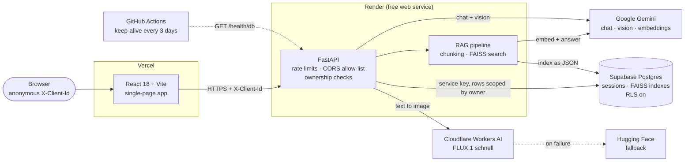
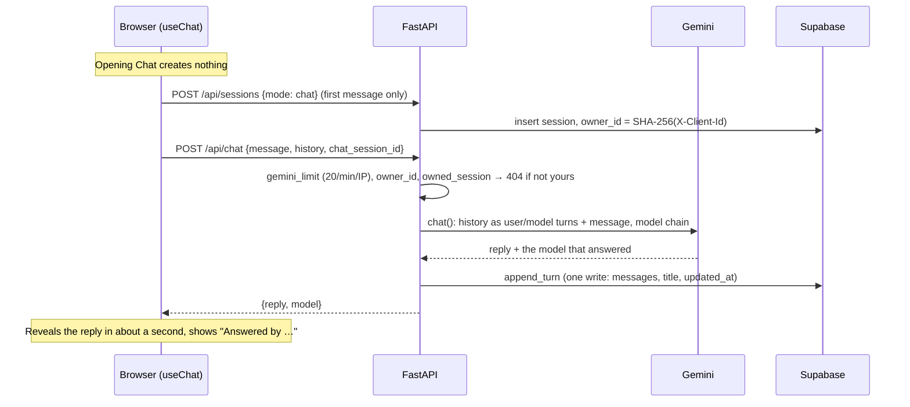
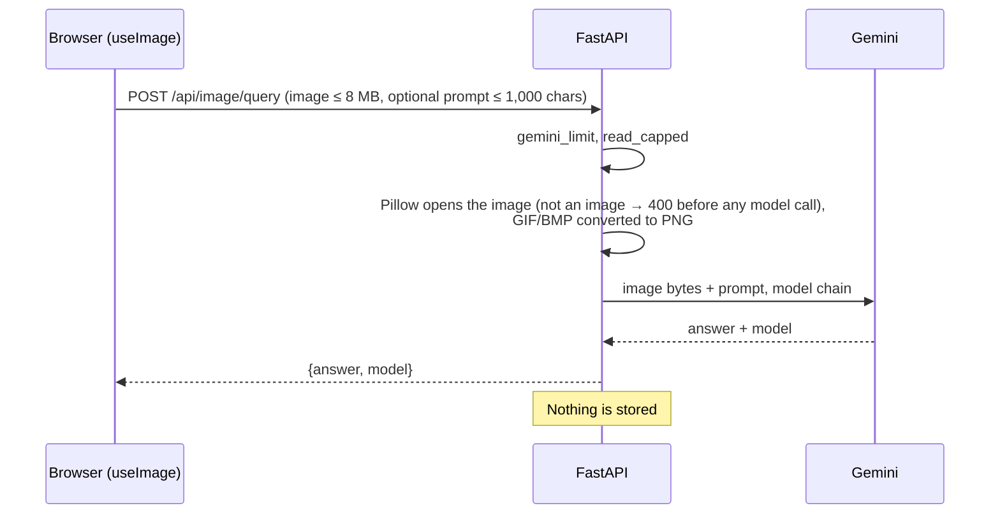
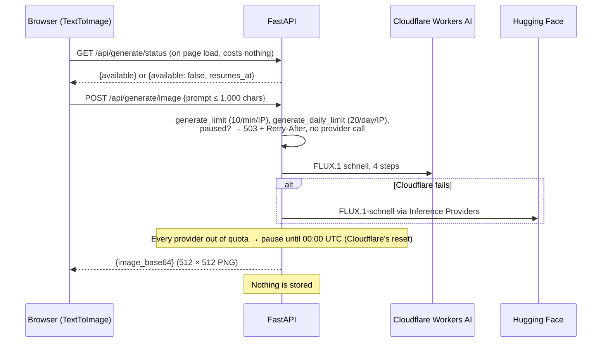
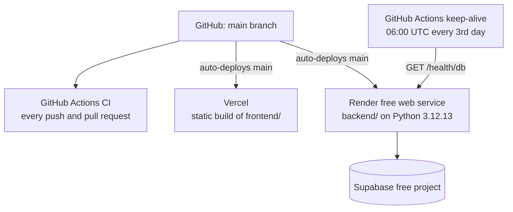

# Architecture

How VisionaryX is put together: what runs where, what happens on each request, and how
visitors' data is kept apart. For the retrieval pipeline in detail, see
[RAG_DEEP_DIVE.md](RAG_DEEP_DIVE.md).

**Contents:** [Components](#components) · [Request lifecycles](#request-lifecycles) ·
[Deployment](#deployment) · [Security model](#security-model)

---

## Components

| Component | Code | Role |
|---|---|---|
| Single-page app | `frontend/src/` | Pages, hooks per feature (`hooks/useChat.js`, `usePDF.js`, `useImage.js`), one axios client (`api/client.js`) that adds `X-Client-Id` to every call |
| API | `backend/main.py`, `backend/routers/` | Middleware (size limit, error catch, CORS, request log), one router per feature |
| Services | `backend/services/` | Gemini calls and the model chain (`gemini_service.py`), RAG (`rag_service.py`), image providers (`image_service.py`) |
| Core | `backend/core/` | Extraction and chunking, embeddings, FAISS codec, Supabase access, rate limits, typed errors |
| Database | `supabase/schema.sql` | Two tables, `sessions` and `faiss_indexes`, with row-level security on |

---

## Request lifecycles

Every request goes from the browser (served by Vercel) straight to the API on Render;
Vercel only serves the static app. On Render, every public request passes through
Cloudflare and Render's load balancer before it reaches FastAPI. Inside FastAPI, each
request passes the middleware in this order: request log, CORS, catch-unhandled (turns
any unexpected exception into a JSON 500 that CORS can still label), and the
`Content-Length` check (413 above 51 MB). Route handlers are plain `def` functions, which
FastAPI runs in its thread pool, so a slow upstream call does not block other requests.

### General Chat

### PDF Chat

Upload: `POST /api/sessions {mode: pdf}`, then `POST /api/pdf/upload` (multipart, up to 5
files of 10 MB, `.pdf` or `.docx`, 5 uploads a minute per IP). The backend extracts and
chunks each file once, embeds the chunks, saves the FAISS index to `faiss_indexes` under
the caller's `owner_id`, asks a lite model for three suggested questions, and links the
index to the chat row. Question: `POST /api/pdf/query`, which loads the caller's index,
retrieves, filters, answers and appends the turn to the chat. Both are drawn step by step
in [RAG_DEEP_DIVE.md](RAG_DEEP_DIVE.md#1-overview).

### Image Query

### Text to Image

### Conversation history

`GET /api/sessions` lists the caller's chats (newest first), `GET /api/sessions/{id}`
loads one, `DELETE /api/sessions/{id}` deletes one and its FAISS index. All three are
filtered by `owner_id` and share a limit of 60 calls a minute per IP. Image Query and Text
to Image create no sessions.

---

## Deployment

| Where | What runs | Configuration (names only) |
|---|---|---|
| **Vercel** | A production build of `frontend/` (Vite), served as static files; `frontend/vercel.json` rewrites every path to `index.html` so deep links work | `VITE_API_URL` |
| **Render** | The FastAPI app from `backend/`, Python version from `backend/.python-version`. Free instance: stops after 15 minutes without traffic, about a minute to start again | `GOOGLE_API_KEY`, `SUPABASE_URL`, `SUPABASE_SERVICE_KEY`, `ALLOWED_ORIGINS`, `HUGGINGFACEHUB_API_TOKEN`, `CLOUDFLARE_ACCOUNT_ID`, `CLOUDFLARE_API_TOKEN`; optional `GEMINI_MODELS`, `GEMINI_SUGGEST_MODELS`, `TRUSTED_PROXY_HOPS`, `LOG_LEVEL` |
| **Supabase** | Postgres with the two tables from `supabase/schema.sql`, reached through its REST API | — |
| **Google AI Studio** | Gemini models and embeddings, free tier | (the key above) |
| **Cloudflare** | Workers AI, free allowance of 10,000 neurons a day | (the account ID and token above) |
| **GitHub Actions** | `ci.yml`: ruff (backend and `scripts/`) and pytest; ESLint, Vitest and a production build of the frontend. `keep-alive.yml`: `GET /health/db` with up to 4 attempts (180 s timeout, 45 s apart) to ride out a cold start | — |

**Keep-alive.** A free Supabase project pauses after a week without activity.
`/health/db` runs one tiny query, which counts as activity, and the workflow calls it at
06:00 UTC on days 1, 4, 7, … of each month (`0 6 */3 * *`). GitHub disables scheduled workflows after 60 days
without repository activity; the README says how to re-enable it.

**Cold start.** The frontend pings `/health` on each page load. If the answer takes more
than 3 seconds, a notice says the free server is starting; if it fails, the notice offers a
retry (`frontend/src/api/health.js`). The axios client waits up to 120 seconds for a
response.

---

## Security model

There are no accounts. Separation between visitors rests on an anonymous ID and on the
backend being the only thing that can reach the database.

**1. An anonymous ID per browser.** On first use the browser generates a random 32-character
ID (`crypto.randomUUID()` without dashes) and keeps it in `localStorage` as
`vx_client_id`; if storage is blocked it lives for the tab only
(`frontend/src/utils/clientId.js`). It is sent as `X-Client-Id` on every API call. The
backend accepts only 16 to 64 letters, digits, `_` or `-` (400 otherwise).

**2. Only the hash is stored.** `owner_id` (`backend/routers/deps.py`) stores
`SHA-256(X-Client-Id)` as hex. The ID works like a bearer token, so a leaked database row
does not hand out a working ID: the hash cannot be sent back as a header.

**3. 404, not 403.** Every read, update and delete of a session or index filters by
`owner_id` (`backend/core/storage.py`). Someone else's session is indistinguishable from
one that does not exist: both answer 404. A 403 would confirm that the ID exists. The
check runs before any model call, so a guessed ID costs no quota. Tests:
`backend/tests/test_sessions.py`.

**4. Row-level security.** RLS is enabled on both tables with **no policies**, so
Supabase's public keys can read and write nothing. The backend uses the secret service key
(kept only in Render's environment), which bypasses RLS; the ownership filter in the code is
what separates visitors. The migration that introduced this is
`backend/migrations/001_session_ownership.sql`.

**5. CORS allow-list.** `ALLOWED_ORIGINS` lists the origins that may call the API from a
browser (the Vercel site, and `localhost` for development); trailing slashes are ignored.
An empty value stops the app at start-up instead of silently blocking the site. Tests:
`backend/tests/test_cors.py`.

**6. Rate and size limits** (`backend/core/rate_limit.py`, `backend/routers/deps.py`):

| Limit | Value |
|---|---|
| Gemini routes (chat, PDF question, image question), shared | 20 a minute per IP |
| Uploads | 5 a minute per IP |
| Image generation | 10 a minute and 20 a day per IP |
| Session calls | 60 a minute per IP |
| Upload | 5 files, 10 MB each; whole request 51 MB (checked from `Content-Length` before parsing) |
| Image query | 8 MB |
| Text | messages 20,000 characters, prompts 1,000, history trimmed to the last 40 messages |

The limits are sliding windows kept in memory (one deque of timestamps per IP), which suits
a single Render instance; they reset on restart. The client IP is read from
`CF-Connecting-IP`. [Render's guide to running PocketBase](https://render.com/articles/host-pocketbase-on-render)
says Cloudflare writes that header on every request that reaches a Render web service,
overwriting whatever the caller sent. `X-Forwarded-For` is only a fallback, counted from the
right (`TRUSTED_PROXY_HOPS`, default 1), because proxies append to it and the leftmost
entries are whatever the caller sent.

**7. Secrets and errors.** All keys live in Render's environment (and `backend/.env`
locally, which is gitignored); the frontend holds none. Model failures reach the user as
fixed messages (quota, unavailable, timeout); the upstream error text is kept in the log
only. The test suite never reads `backend/.env` and blocks real Cloudflare calls.

**8. Stored indexes cannot run code.** Indexes are JSON; older pickled indexes are read by
a data-only unpickler that refuses every class except two inert stand-ins
([RAG_DEEP_DIVE.md](RAG_DEEP_DIVE.md#8-storage)).

What is stored, and for how long, is in [SECURITY.md](../SECURITY.md).
