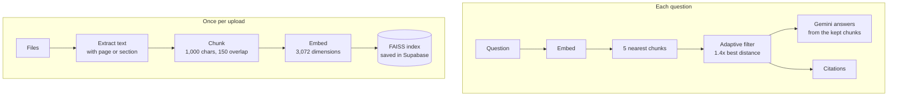
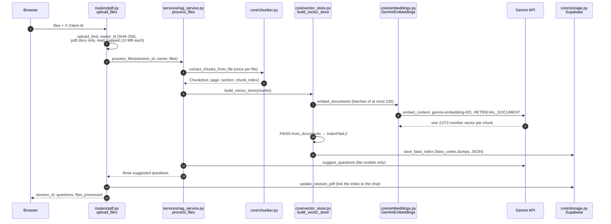
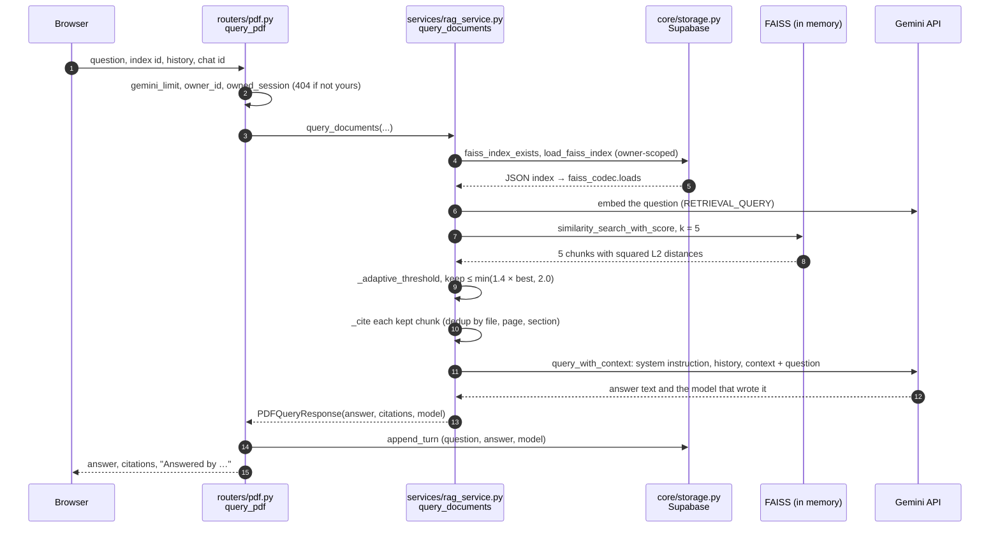

# RAG in VisionaryX: a deep dive

This document explains retrieval-augmented generation (RAG) using VisionaryX's real code.
Every number in it is read from the code or measured on a real run; file paths are given so
you can check each step yourself. If you are new to the terms, start with the
[glossary](#11-glossary).

**Contents:** [1. Overview](#1-overview) · [2. Extraction](#2-extraction) ·
[3. Chunking](#3-chunking) · [4. Embeddings](#4-embeddings) ·
[5. Vector search](#5-vector-search) · [6. Prompt assembly](#6-prompt-assembly) ·
[7. Citations](#7-citations) · [8. Storage](#8-storage) ·
[9. Worked example](#9-worked-example) ·
[10. Limitations](#10-limitations-and-what-production-systems-add) ·
[11. Glossary](#11-glossary) · [Try it yourself](#try-it-yourself)

---

## 1. Overview

A language model only knows what it was trained on. RAG gives it your documents at the
moment you ask: the documents are cut into passages ("chunks") ahead of time, each passage
is turned into a vector that captures its meaning, and each question is turned into a
vector the same way. The passages whose vectors are closest to the question's are pasted
into the prompt, and the model is told to answer from them only. Because the code knows
exactly which passages it sent, it can show them as sources.



### (a) Upload and indexing

`POST /api/pdf/upload` (`backend/routers/pdf.py`, `upload_files`):



### (b) A question and its answer

`POST /api/pdf/query` (`backend/routers/pdf.py`, `query_pdf`):



---

## 2. Extraction

`backend/core/chunker.py`. Extraction must keep **where** each piece of text came from,
because that location becomes the citation.

### PDF: page by page

`extract_chunks_from_pdf` reads the file with `pypdf` and processes each page separately,
numbering pages from 1. For each page, `_safe_extract_text` tries four strategies in order
and keeps the first that returns non-blank text:

1. `page.extract_text()`: pypdf's standard extraction.
2. `page.extract_text(extraction_mode="layout")`: layout mode, which can recover text that
   the standard mode loses in unusual layouts.
3. A pass over `page._objects`, calling `get_text()` on each. pypdf's page objects do not
   have an `_objects` attribute, so this strategy never applies with the pinned pypdf
   (4.1.0); it is a leftover from an earlier version of the code.
4. `page.extract_text(visitor_text=...)`: a callback receives each text fragment, which is
   re-encoded as UTF-8 with undecodable characters dropped.

Each strategy is wrapped in `try`/`except`, so a page that breaks one strategy falls
through to the next. A page where all four return nothing is skipped.

**Encoding and cleaning** (`_clean_text`): characters that cannot be encoded as UTF-8
(such as lone surrogates) are dropped, null bytes become spaces, runs of spaces and tabs
collapse to one space, spaces around line breaks are removed, and three or more line
breaks become two. Line and paragraph breaks are **kept**, because the splitter (next
section) cuts on them first.

**Scanned PDFs are refused.** If no page yields any text, the upload fails with
`DocumentProcessingError`: *"No readable text found in PDF. The file may be scanned or
image-based."* There is no OCR, so a scan is refused rather than indexed empty
(`backend/tests/fixtures/scanned_page.pdf` tests this).

### DOCX: headings become sections

A Word file has no pages. `extract_chunks_from_docx` walks the document body **in order**
with `python-docx`'s `iter_inner_content()`, which yields paragraphs and tables as they
appear:

- A paragraph whose style name starts with `Heading` starts a new section; the heading
  text is also the section's first line.
- Other paragraphs are added to the current section. Text before the first heading
  belongs to a section with no name (`None`). A document title in Word's *Title* style is
  not a heading, so it lands there too.
- A table is read **row by row**: each row's non-empty cell texts, de-duplicated (merged
  cells repeat their text) and joined with ` | `, one row per line. The table stays in the
  section it appears in.

Every DOCX chunk gets `page = 0` and its section name. A `.doc` file (the old binary
format) is refused in `backend/routers/pdf.py` before any processing, because
`python-docx` cannot read it.

---

## 3. Chunking

`_split_pages` in `backend/core/chunker.py` uses LangChain's
`RecursiveCharacterTextSplitter`:

| Setting | Value |
|---|---|
| `chunk_size` | 1,000 characters (measured with `len`, not tokens) |
| `chunk_overlap` | 150 characters |
| `separators` | `"\n\n"`, `"\n"`, `". "`, `" "`, `""` (in that order of preference) |
| `keep_separator` | `True` (the library's default for this class) |

**How recursive character splitting works.** The splitter takes the first separator in the
list that occurs in the text (normally a paragraph break) and splits on it. It then merges
consecutive pieces back together until adding the next would pass 1,000 characters, which
closes a chunk; the next chunk starts with up to 150 characters carried over from the end
of the previous one. Any single piece that is still longer than 1,000 characters is split
again with the next separator in the list: lines, then sentences, then words, and as a last
resort individual characters (`""`). The result is chunks that end at the most natural
boundary available.

**Splitting happens per page or per section.** `_split_pages` splits each PDF page and each
DOCX section on its own, so a chunk never spans two pages or two sections. That is what
makes a citation like "page 4" or "section Budget" exact.

**Why these values.** They come from the original version of the project, and they sit in
the usual range for RAG. The trade-off:

- **Smaller chunks** (say 300 characters) match a question more precisely, but each one
  carries less context, an answer is more likely to be cut in half, and there are more
  vectors to store and search.
- **Larger chunks** (say 3,000) keep more context together, but a chunk about several
  topics gets a blurred vector that matches no question well, and each one takes more of
  the prompt.
- **Overlap** keeps a sentence that straddles a boundary readable in at least one chunk,
  at the cost of storing about 15% of the text twice when chunks are full.

The example files in this repo are short: every page and section is under 1,000
characters, so each becomes exactly one chunk (see the [worked example](#9-worked-example)).
Long documents are where the recursive splitting and the overlap come into play.

---

## 4. Embeddings

`backend/core/embeddings.py`, class `GeminiEmbeddings` (a LangChain `Embeddings`
implementation on Google's `google-genai` SDK).

| | Value |
|---|---|
| Model | `gemini-embedding-001` |
| Dimensions | 3,072 (the model's default; measured on the worked example) |
| Task type for chunks | `RETRIEVAL_DOCUMENT` |
| Task type for questions | `RETRIEVAL_QUERY` |
| Batching | at most 100 texts and about 20,000 tokens per request (tokens estimated as characters ÷ 4 + 1) |
| Vector length | 1.0000 for every vector in the worked example: the vectors arrive normalised |

**An embedding** is a list of numbers (here 3,072) produced by a neural network so that
texts with similar meaning get vectors that point in similar directions. Similarity of
meaning becomes geometric closeness, which a computer can search quickly.

**Why two task types.** A question ("When will it open?") and the passage that answers it
("The building is due to open on 1 September 2026") look different: one is short and asks,
the other is longer and states. The model is trained to embed queries and documents
differently (asymmetric retrieval) so that a question lands near the passages that
**answer** it, not near other questions that merely resemble it. Using the document task
for chunks and the query task for questions is what the model expects.

**Compatibility with old indexes.** When the project moved from the deprecated
`google-generativeai` / `langchain-google-genai` libraries to `google-genai` (commit
`8aa99f2`), every index saved before the move had to keep matching new questions. The new
class keeps the same model, task types, default dimension and batching. This was checked
against the real API: vectors from the old and new code had cosine similarity 1.000000,
and an index built with the old library returned the same chunks at the same distances.
`backend/tests/test_embeddings.py` pins the model, the task types and the batching.

---

## 5. Vector search

### The index: exact search with squared Euclidean distance

`build_vector_store` (`backend/core/vector_store.py`) calls `FAISS.from_documents` with
LangChain's defaults, which create a **`faiss.IndexFlatL2`**:

- **Flat** means no compression or clustering: every vector is stored as is, and a search
  compares the question with **every** vector. The result is exact.
- **L2** means Euclidean distance. FAISS returns the **squared** distance
  (Σ (aᵢ − bᵢ)²), and lower is closer. The walkthrough script checks this: FAISS's score
  for the best chunk was 0.474294, and the squared distance computed by hand was 0.474294.
- `normalize_L2` is `False`: LangChain does not normalise the vectors. They are already of
  length 1 when Gemini returns them (measured above).

Because the vectors have length 1, squared distance and cosine similarity carry the same
information: **d = 2 − 2 · cos θ**. A distance of 0 means identical direction, 2 means
unrelated (perpendicular), and 4 would mean opposite. The best chunk in the worked
example, at 0.4743, has cosine similarity 1 − 0.4743 / 2 ≈ 0.763.

### Why exact search fits this scale

A flat search costs O(N · d) per question: N chunks times d = 3,072 dimensions. Each chat
has its own small index, built from at most 5 files of 10 MB each. The worked example has
N = 9, about 28,000 multiply-adds; even 10,000 chunks would be about 31 million, a few
milliseconds on one CPU core. Approximate (ANN) indexes such as IVF or HNSW trade a little
accuracy and extra build time for speed, which pays off at hundreds of thousands to
millions of vectors. At this scale, exact search is simpler and never misses a match.

### k and the adaptive threshold

`query_documents` (`backend/services/rag_service.py`) asks for the **k = 5** nearest
chunks, then filters them with `_adaptive_threshold`:

```python
best = min(scores)
threshold = min(best * 1.4, 2.0)
```

A chunk is kept if its distance is **at most 1.4 × the best distance**, capped at 2.0
(perpendicular, in cosine terms). The bar moves with each question: when the best match is
very close, only chunks nearly as close survive; when every match is loose, the bar is
loose too. A fixed cut-off would either reject everything for a vaguely worded question or
let weak chunks through for a precise one.

The best chunk always passes unless its own distance is above 2.0, that is, unless even
the closest chunk points away from the question. In that case nothing passes, and the
**top 2** are used anyway, so the model always has some context.

**Worked numbers** (from the [worked example](#9-worked-example)): the best distance was
0.4743, so the threshold was min(0.4743 × 1.4, 2.0) = 0.6640.

| Rank | Distance | ≤ 0.6640? | Chunk |
|---|---|---|---|
| 1 | 0.4743 | kept | DOCX, section *Schedule* |
| 2 | 0.5048 | kept | DOCX, section *Purpose* |
| 3 | 0.5660 | kept | DOCX, section *Budget* |
| 4 | 0.6399 | kept | PDF, page 4 |
| 5 | 0.6780 | dropped | DOCX, section *Contacts* |

---

## 6. Prompt assembly

`query_with_context` in `backend/services/gemini_service.py`.

**Order and labels.** The kept chunks go into the context in retrieval order, nearest
first. They are **not numbered**; they are joined with a separator line:

```text
<chunk 1 text>

---

<chunk 2 text>
```

Each chunk starts with its own first line, which for a DOCX section is the heading (for
example `Schedule`), so the model sees section names even though they are not added as
labels. The citation cards in the UI are numbered in the same order.

**The system instruction** (`RAG_INSTRUCTION`), sent as Gemini's `system_instruction`
rather than as part of the user's message:

```text
You are a precise document assistant. Answer ONLY from the provided context.
If the answer is not in the context, say: "This information is not available in the uploaded documents."
Always be specific and cite relevant details from the context.
```

**The final user turn** is `Context:\n{context}\n\nQuestion: {question}`.

**Conversation history.** The browser sends the earlier questions and answers of this PDF
chat (`frontend/src/hooks/usePDF.js`). The backend keeps the last 40 messages
(`MAX_HISTORY_MESSAGES` in `backend/models/schemas.py`) and sends them as real turns before
the new one, user turns as `user` and answers as `model` (Gemini's name for the
assistant), skipping empty ones. Only the old answers are sent, not the chunks they were
built from, so a follow-up question gets its own fresh retrieval.

**"Not in the documents."** The system instruction gives the model one exact sentence to
use when the context does not contain the answer. This is an instruction, not a guarantee:
it relies on the model following it. Separately, if the index returns no chunks at all,
the code answers *"No relevant content found in the uploaded documents."* without calling
the model.

**Which model.** The answer comes from the first model in the chain
(`gemini-2.5-flash`, then `gemini-3.5-flash-lite`, then `gemini-3.1-flash-lite`) that
responds; on a 429, 404, 500, 503, 504 or a timeout the next is tried. The response
records which one answered, and the UI shows it.

---

## 7. Citations

`_cite` in `backend/services/rag_service.py` builds a `Citation`
(`backend/models/schemas.py`) for each kept chunk:

| Field | Value |
|---|---|
| `source` | the file name |
| `page` | PDF page number, or 0 for DOCX |
| `section` | DOCX heading, or `None` |
| `chunk` | the first 200 characters of the chunk, followed by `...` |

**Deduplication.** One card per distinct `(source, page, section)`: two chunks from the
same page produce one card. Without the file name, "page 1" would be ambiguous when several
documents are uploaded.

**Why the cards cannot be hallucinated.** They are built from the chunks the code sent to
the model, before the model is called, and never parsed out of the model's text. A card
can only show a passage that really exists in your file. Two honest limits follow from
this design:

- A card is shown for every chunk that was **sent**, whether or not the answer used it. In
  the worked example the *Purpose* section is cited although the answer does not draw on
  it.
- The model's own prose can still mention a source (the worked example's answer says
  "(Budget, Finance)"). Those words are model output and are not checked; the cards are
  the reliable record.

---

## 8. Storage

### The JSON FAISS codec

An index is saved to the `faiss_indexes` table by `save_faiss_index`
(`backend/core/storage.py`) in the format written by `faiss_codec.dumps`
(`backend/core/faiss_codec.py`):

```json
{
  "format": "visionaryx-faiss/1",
  "index": "<faiss.serialize_index(...) as base64>",
  "ids": ["<docstore id of vector 0>", "..."],
  "docs": {"<id>": {"text": "<chunk text>", "metadata": {"source": "...", "page": 4, "section": null, "chunk_index": 0}}}
}
```

The whole JSON is then base64-encoded once more into the `index_b64` text column. Each
3,072-dimension vector is 12,288 bytes as float32, so the two base64 layers store it in
about 21,800 characters; that is fine at this scale and the price of keeping the existing
text column (see [Limitations](#10-limitations-and-what-production-systems-add)).

### Why pickle was dangerous, and how old indexes still load

Indexes saved before this format were Python **pickles** (LangChain's `index.faiss` and
`index.pkl`, wrapped in an outer pickle). Unpickling can call any function the data names,
through `__reduce__`, so anyone able to write a row could have run code on the server when
it was loaded. LangChain even requires `allow_dangerous_deserialization=True` to load one.

`faiss_codec.loads` reads the new JSON format directly. For an old pickle it uses
`_DataOnlyUnpickler`, which overrides `find_class`: the only two classes those files contain
(`InMemoryDocstore` and `Document`) map to inert stand-ins that just record their field
values, and any other class raises `UnpicklingError`. No class code runs. The tests in
`backend/tests/test_faiss_codec.py` check that an old blob and the new format load to the
same ids, texts, metadata, vectors and search results, and that tampered pickles (inner
and outer) are refused without executing.

### Per-browser ownership

Every index row has an `owner_id`: the SHA-256 of the browser's anonymous `X-Client-Id`
(`owner_id` in `backend/routers/deps.py`). `faiss_index_exists` and `load_faiss_index`
filter by it, so someone else's index behaves exactly like a missing one (404). Deleting a
chat deletes its index too (`delete_session`). The original files are never stored: only
the chunk texts and vectors inside the index.

---

## 9. Worked example

Run on 2026-10-31 with [`scripts/rag_walkthrough.py`](../scripts/rag_walkthrough.py) on
both files in [`examples/`](../examples/) (fictional data), with the question:

> When will the new cold-storage building open, and what will it cost?

It made **3 Gemini calls**: one `gemini-embedding-001` request for all 9 chunks, one
`gemini-embedding-001` request for the question, and one generation call answered by
`gemini-2.5-flash`. The index was kept in memory only, so the run created no data. (The app
itself also calls a lite model once per upload for the suggested questions; the script
skips that.)

**Chunks.** Every page and section was under 1,000 characters, so each became one chunk:

| # | Source | Location | Chars | Starts with |
|---|---|---|---|---|
| 0 | annual report (PDF) | page 1 | 197 | Lumen Ridge Orchard Co-op: 2025 Annual Report |
| 1 | annual report (PDF) | page 2 | 210 | Harvest Results |
| 2 | annual report (PDF) | page 3 | 188 | Water and Sustainability |
| 3 | annual report (PDF) | page 4 | 184 | Finance |
| 4 | cold-storage plan (DOCX) | no section (title) | 151 | Lumen Ridge Orchard Co-op: Cold-Storage Plan |
| 5 | cold-storage plan (DOCX) | *Purpose* | 167 | Purpose |
| 6 | cold-storage plan (DOCX) | *Schedule* | 231 | Schedule, including the table |
| 7 | cold-storage plan (DOCX) | *Budget* | 128 | Budget |
| 8 | cold-storage plan (DOCX) | *Contacts* | 81 | Contacts |

Chunk 6 shows the table reading in action:

```text
Schedule

Groundworks start in March 2026. The building is due to open on 1 September 2026, in time for the 2026 harvest.

Stage | Target date
Groundworks | March 2026
Cooling system installed | July 2026
Opening | 1 September 2026
```

**Embeddings.** A 9 × 3,072 matrix; every vector had length 1.0000. The question's vector
also had length 1.0000. The index was an `IndexFlatL2` with 9 vectors.

**Retrieval.** The five nearest chunks and the threshold of 0.6640 are in the table in
[section 5](#k-and-the-adaptive-threshold). Four chunks were kept, 731 characters of
context in total. The two facts the question needs come from different files: the opening
date from the DOCX (*Schedule*), the cost from both the DOCX (*Budget*) and the PDF
(page 4: "The board approved a new cold-storage building costing 600,000 credits").

**Answer** (`gemini-2.5-flash`):

> The new cold-storage building is due to open on **1 September 2026** (Schedule). The
> approved budget for the building is **600,000 credits** (Budget, Finance).

**Citations:**

1. `lumen_ridge_cold_storage_plan.docx`, section *Schedule*
2. `lumen_ridge_cold_storage_plan.docx`, section *Purpose*
3. `lumen_ridge_cold_storage_plan.docx`, section *Budget*
4. `lumen_ridge_annual_report_2025.pdf`, page 4

The model writes its answer afresh each time, so a new run may word it differently; the
chunks, distances and citations depend only on the files, the question and the embedding
model.

---

## 10. Limitations and what production systems add

What VisionaryX does not do, and what larger systems typically add:

- **Reranking.** The five nearest chunks are taken by vector distance alone. Production
  systems often fetch more candidates (say 50) and reorder them with a cross-encoder, a
  model that reads the question and each passage together and scores relevance more
  accurately than comparing two separately made vectors.
- **Hybrid search (BM25 + vectors).** Vector search is good at meaning but can miss exact
  terms: part numbers, names, rare words. BM25 is a keyword-ranking formula that scores
  documents by how often the question's words appear, weighted by how rare they are.
  Hybrid systems run both and merge the rankings (for example with reciprocal rank
  fusion).
- **OCR.** Scanned PDFs are refused. Optical character recognition would turn page images
  into text before chunking.
- **Evaluation sets.** There is no automated measure of retrieval quality yet. The usual
  method is a set of questions, each labelled with the chunk(s) that answer it, scored
  with **recall@k** (how often a correct chunk is among the top k), **MRR** (mean
  reciprocal rank: how high the first correct chunk appears) and, for the answers,
  checks of faithfulness to the context. A fixed set run on every change shows whether a
  new chunk size, threshold or model helps or hurts. The worked example above is one such
  case, checked by hand.
- **Streaming.** Answers arrive whole and are then revealed in about a second. Streaming
  would show the first words while the model is still writing.
- **Large-scale ANN indexes.** With one large shared collection instead of small per-chat
  indexes, an approximate index (IVF, HNSW) or a vector database would replace the flat
  index, and storing vectors in a binary or `pgvector` column would avoid the double
  base64 encoding described in [section 8](#the-json-faiss-codec).
- **Smarter chunking.** Splitting by characters ignores meaning. Alternatives split by
  tokens, by document structure (headings in PDFs too), or by detected topic shifts, and
  some attach a summary of the surrounding section to each chunk.

---

## 11. Glossary

| Term | Meaning |
|---|---|
| **RAG** (retrieval-augmented generation) | Answering a question by first retrieving relevant passages from your own documents, then asking a language model to answer from them |
| **Chunk** | A passage of a document (here up to 1,000 characters), the unit that is embedded, retrieved and cited |
| **Chunk overlap** | Characters repeated at the start of a chunk from the end of the previous one, so text at a boundary is not lost |
| **Embedding** | A list of numbers (a vector) representing a text's meaning; similar texts get nearby vectors |
| **Dimension** | The number of values in an embedding: 3,072 here |
| **Normalised vector** | A vector of length 1; for these, distance and cosine similarity are interchangeable |
| **Cosine similarity** | How closely two vectors point the same way: 1 = same direction, 0 = unrelated |
| **Euclidean (L2) distance** | Straight-line distance between two vectors; FAISS's `IndexFlatL2` reports it squared |
| **Task type** | A hint to the embedding model about how a text will be used: as a stored document or as a search query |
| **Vector index** | A data structure that finds the vectors nearest to a query vector |
| **FAISS** | Facebook AI Similarity Search, a library of vector indexes |
| **Flat / exact search** | Comparing the query with every stored vector; always finds the true nearest |
| **ANN** (approximate nearest neighbour) | Indexes such as IVF or HNSW that search only part of the data, much faster at large scale, occasionally missing a match |
| **k / top-k** | How many nearest chunks to fetch: 5 here |
| **Threshold** | The distance a chunk must be within to be used; here 1.4 × the best match's distance |
| **Context** | The retrieved text placed in the prompt for the model to answer from |
| **System instruction** | Standing instructions sent to the model separately from the conversation, such as "answer only from the context" |
| **Grounding** | Making the model answer from given sources rather than from what it learned in training |
| **Hallucination** | Fluent output that is not supported by the sources or by fact |
| **Citation** | A pointer from an answer to the passage it came from: file, page or section, and an excerpt |
| **Reranking** | Reordering retrieved passages with a slower, more accurate relevance model |
| **BM25** | A classic keyword-ranking formula used by search engines |
| **Recall@k / MRR** | Measures of retrieval quality: whether, and how high, the right passage appears in the results |
| **Pickle** | Python's object serialisation format; loading untrusted pickles can run arbitrary code |
| **OCR** | Optical character recognition: reading text from images, such as scanned pages |

---

## Try it yourself

[`scripts/rag_walkthrough.py`](../scripts/rag_walkthrough.py) runs the same pipeline on any
PDF or DOCX files and prints every stage: the chunks with their page or section, the
embedding matrix's shape and vector lengths, the FAISS index type, each retrieved chunk's
distance and whether it passed the threshold, the context, the citations and the answer.
It keeps the index in memory and writes nothing to Supabase.

From `backend/`, with the backend's environment installed (see the
[README](../README.md#run-it-locally)) and `GOOGLE_API_KEY` in `backend/.env`:

```bash
cd backend
python ../scripts/rag_walkthrough.py \
    ../examples/lumen_ridge_annual_report_2025.pdf \
    ../examples/lumen_ridge_cold_storage_plan.docx \
    -q "When will the new cold-storage building open, and what will it cost?"
```

Options: `--no-answer` stops after retrieval (2 Gemini calls instead of 3), `--json run.json`
writes every stage to a file, `--show N` prints the first N chunks (default 12). Without a
key it stops at once with `error: GOOGLE_API_KEY is not set...` and exit code 2.
`backend/tests/test_rag_walkthrough.py` runs the script offline with fake models in CI.
